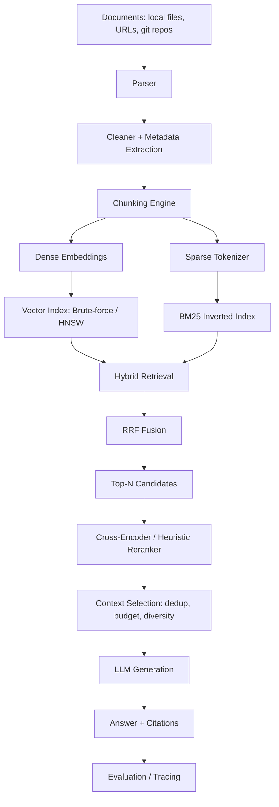

# Architecture

## Pipeline overview



## Layering

```
src/rag_engine/
  retrieval/    <- pure algorithms (tokenizer, TF-IDF, BM25, cosine, ANN, RRF).
                   Depends on nothing but numpy + stdlib. Fully unit-testable
                   in isolation (spec's "pure core algorithms" requirement).
  chunking/     <- pure algorithms (fixed/recursive/markdown/code/semantic/
                   parent-child). Depends only on retrieval.cosine (for
                   semantic chunking) and stdlib.
  embeddings/   <- provider abstraction + two implementations (offline
                   hashing embedder, network-backed sentence-transformers).
  reranking/    <- heuristic (offline) + cross-encoder (network) reranker.
  context/      <- dedup, budgeting, compression, selection.
  generation/   <- prompts, citation validation, LLM abstraction, answerer.
  security/     <- SSRF/path-traversal/prompt-injection/authorization.
  ingestion/    <- parsers, cleaners, loaders, pipeline orchestrator.
  evaluation/   <- retrieval + generation metrics, dataset, experiment
                   tracking, reports.
  storage/      <- SQLAlchemy models + repositories (Postgres).
  api/          <- FastAPI app, routes, schemas, in-process engine wiring.
  cli/          <- Typer CLI, calls the exact same engine as the API.
  worker/       <- background job polling loop.
```

The dependency direction is one-way: `api/` and `cli/` depend on
`retrieval/`, `chunking/`, etc, never the other way around. None of the
retrieval/chunking/evaluation modules import FastAPI, SQLAlchemy, or any
specific LLM SDK (spec #115 dependency inversion) -- you can `import
rag_engine.retrieval.sparse.bm25` in a plain Python REPL with zero
infrastructure running, which is exactly how the unit tests exercise it.

## Why an in-memory index rebuildable from Postgres, rather than a live
   pgvector-backed index?

**Persistence.** The BM25 inverted index, ANN structure and hybrid retriever are an in-process
`EngineState`, always *derived* from stored chunk records. Where the records live is `STORE_BACKEND`:
- `postgres` (docker-compose default): documents, versions and chunks are rows in Postgres
  (`storage/postgres_store.py`). Ingest and delete write the **database first**, in one transaction, and
  only then update memory, so memory never holds a document the database lacks and a failed write changes
  nothing (HTTP 503 `persistence_failed`; the same content can be retried). At startup the API reads every
  non-deleted chunk and rebuilds the indexes; `POST /api/v1/index/rebuild` and `rag index build` do the same.
  Startup fails loudly if the database is unreachable or unmigrated. Tenant/visibility/owner ACLs and content
  hashes are stored with each chunk, so access control and duplicate detection survive restarts.
- `none` (default for local use): memory only, with an optional JSON snapshot (`STATE_FILE` for the API,
  `data/indexes/cli_state.json` for the CLI).
Deleting a document soft-deletes the document row and hard-deletes its chunks. The ranking math stays in
Python objects you can step through, not inside a database extension.

The trade-off: this reference implementation's index lives in one
process's memory, so it doesn't horizontally scale across API replicas
without additional work (see docs/deployment.md "Scaling beyond one
process" and docs/troubleshooting.md). That trade-off is deliberate for
this project's stated goal (understanding retrieval, not building a
distributed systems project) and is documented, not hidden.

## Request flow: `POST /api/v1/chat`

1. `HybridRetriever.search()` runs dense + BM25 concurrently (conceptually;
   this reference implementation calls them sequentially -- see
   docs/retrieval.md "Latency" for how to parallelize), fuses via RRF.
2. `Reranker.rerank()` narrows top-50 candidates to top-5 using the
   query-term-coverage heuristic (or a real cross-encoder when
   `sentence-transformers` is installed and network access is available).
3. `ContextSelector.select()` deduplicates, applies the token budget and
   per-document diversity cap.
4. `RagAnswerer.answer()` builds the delimited, citation-instructed
   prompt, calls the LLM, and validates every citation marker against the
   chunks actually supplied.
5. The full `ChatResponse` includes retrieved chunks, per-signal scores,
   fusion explanation, citations, and stage timings -- nothing about *why*
   a chunk was retrieved or selected is hidden from the caller (spec #105).
