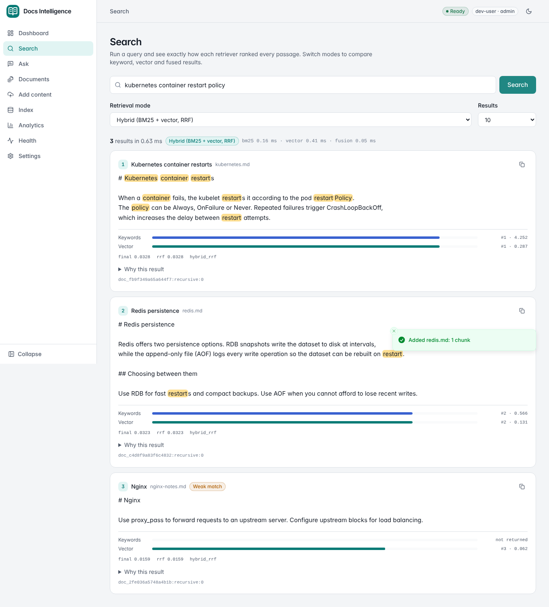
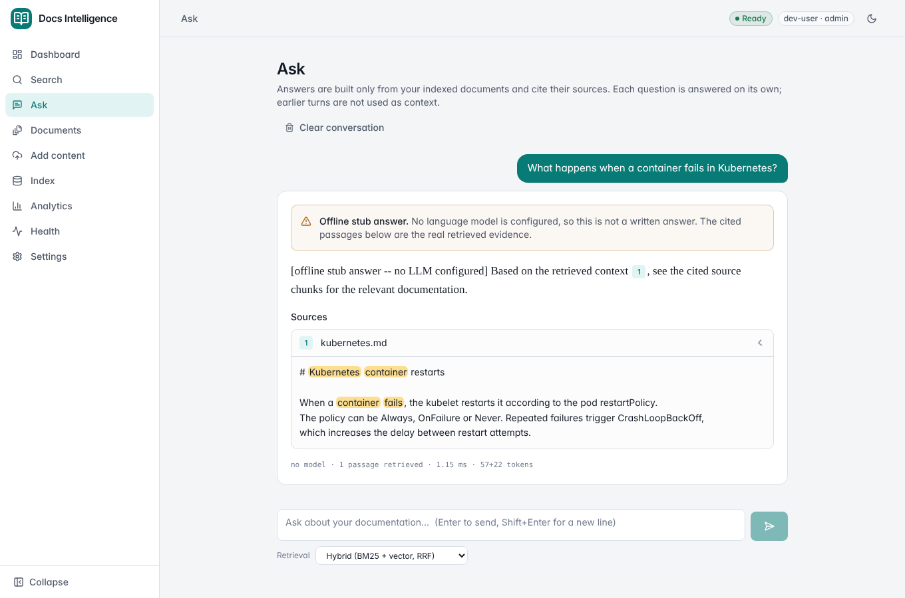
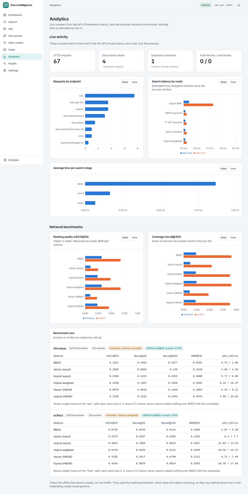

# Web UI

The React console lives in [`frontend/`](../frontend/README.md) and is served by the API at `/` once built.
This page records what was verified and what was not.

## Behaviour worth knowing

- **Weak vector matches are flagged.** The default hybrid mode can return vector-only neighbours that share almost nothing with the
  query (the offline hashing embedder returns a nearest chunk for any input). Results with no keyword match and a vector similarity
  below the server's `MIN_DENSE_SIMILARITY` carry a "Weak match" badge. The Ask page already refuses to answer from such evidence.
- **Ask has no conversation memory.** `POST /api/v1/chat` takes a single question, so each turn is answered independently; the UI says so.
- **Pasted text** is sent as a Markdown file upload, because `POST /documents/ingest` takes its content as a query parameter and
  would break on long text.
- **Unknown URLs return the app shell (HTTP 200)** so client-side routes survive a reload. API paths under `/api/`, `/docs`,
  `/health`, `/ready` and `/metrics` are never shadowed. The UI's health page lives at `/status` for that reason.
- **Private network URLs are blocked** by `POST /documents/ingest-url`. Set `URL_INGEST_ALLOW_PRIVATE=true` only for trusted internal use.
- Chat now uses the configured model: `LLM_PROVIDER=openai_compatible` with `LLM_API_KEY`, or `LLM_PROVIDER=local` for Ollama.
  Before this change the engine always used the offline stub regardless of those settings.

## Verified in this project's sandbox

| Check | Result |
|---|---|
| `npm run typecheck`, `npm run lint` | clean |
| Unit tests (Prometheus parser, API client errors and headers, credential storage, highlight, score strip) | 21 pass |
| Production build, also from a clean copy with `npm ci` | succeeds, identical bundle hash |
| Browser tests against real servers | 15 pass: every page, upload/duplicate/unsupported file, SSRF block, delete with confirmation, all five retrieval modes, cited stub answer and insufficient-evidence reply, rebuild, charts with table view, theme and sidebar persistence, sign-in, role limits, metrics token, tenant isolation, a generated Markdown answer with clickable `[n]` citations, mobile layout |
| Backend | 282 tests pass, `ruff` and `mypy` clean, `validate_project.py` 5 of 5 |
| Vite dev proxy to a live API | works |
| API with `STORE_BACKEND=postgres` | `/ready` reports the database check passing, `/api/v1/info` reports `postgres` |

## Not verified

- A real LLM answer. No key was available. The generated-answer path (provider call, citation validation, Markdown and `[n]` chips) was
  exercised against `frontend/e2e/fake_llm.py`, a local stand-in that speaks the OpenAI chat-completions protocol and returns fixed text.
  That checks the wiring and rendering, not what a real model would write.
- A real embedding model, and result quality with one.
- The Docker image build and the CI workflow jobs added for the frontend (the sandbox has no Docker daemon or GitHub runner).
- Browsers other than Chromium.
- Uploads of large PDFs through the UI, and corpora beyond a few thousand documents (the documents table filters and pages in the browser).
- Screen-reader testing. Keyboard focus, labels, roles and reduced motion were built in and the e2e tests locate controls by role and label, but no assistive technology was used.
